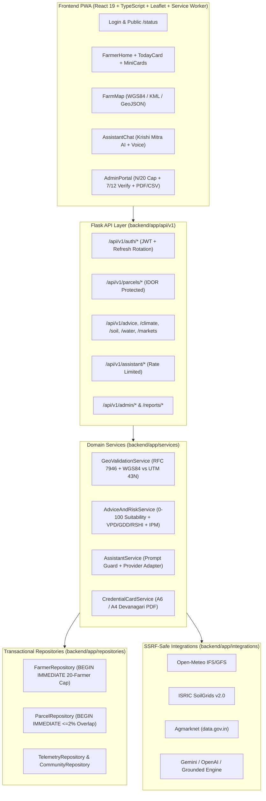
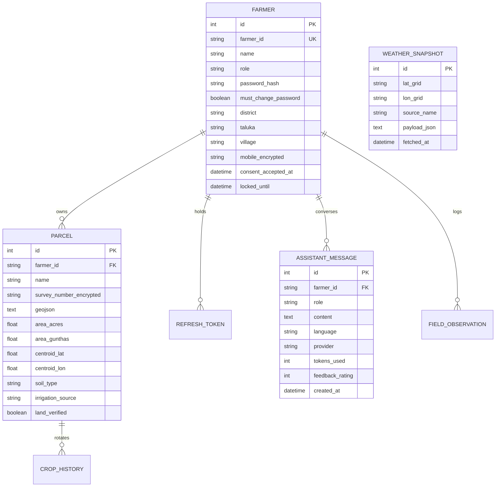

# Kshetra (क्षेत्र) — System Architecture

Kshetra (formerly TERRAWISE AI) is a production-grade agricultural decision support platform built for smallholder farmers and extension officers in **Ahilya Nagar** and **Nashik**, Maharashtra.

---

## 1. Layered System Architecture

---

## 2. Database Entity-Relationship Diagram

---

## 3. Core Architectural Invariants

1. **Zero Demo in Production**: No demo routes, no seeded fake farmers, and no synthetic fallback numbers exist in production code. `scripts/check_no_demo.py` enforces this in CI/pre-commit.
2. **Missing Is Not Zero (`G2`)**: `safe_value()` wraps every telemetry value so `None` renders `"No data"` (`"माहिती नाही"` / `"कोई जानकारी नहीं"`), while `0.0` renders `"0.0 mm"`. Every metric carries a `provenance` object with source name and UTC timestamp.
3. **Atomic 20-Farmer Cap**: `FarmerRepository.create_farmer_atomic()` acquires an immediate write lock (`BEGIN IMMEDIATE` on SQLite / `SELECT ... FOR UPDATE` on PostgreSQL) before counting active farmers and inserting a new record.
4. **Dual-CRS Geodesic Polygon Validation**: `GeoValidationService` validates RFC 7946 topology, minimum 0.5m vertex spacing, containment inside Ahilya Nagar or Nashik, and cross-checks WGS84 ellipsoid geodesic area against UTM Zone 43N (`EPSG:32643`) projected area (`< 0.5%` divergence).
