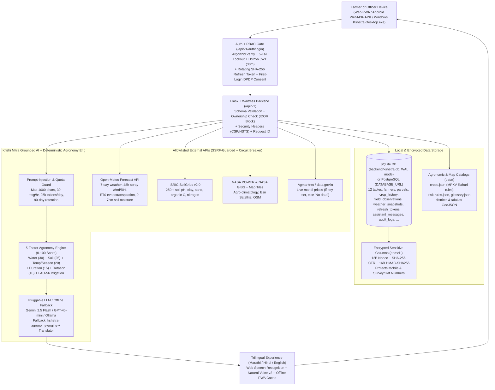

# Kshetra — System Architecture, Security, Storage, APIs, AI Grounding & Simple Q&A Guide

> **Plain-language guide + technical reference** for reviewers, agricultural officers, and farmers. Every mechanism described below maps directly to the running code in this repository.

---

## 1. End-to-End Working Flowchart (Website, Desktop `.exe`, Mobile WebAPK / `.apk`)

---

## 2. Direct Technical Answers

### A. What Security Does Kshetra Use?
- **Password Hashing (`backend/app/security/__init__.py`)**: Uses **Argon2id** (`PasswordHasher(time_cost=2, memory_cost=32768, parallelism=2)`) with **OWASP PBKDF2-HMAC-SHA256** (`600,000` iterations + 16-byte random salt) as fallback. Officer-issued temporary passwords are randomly generated in readable `Word1-Word2-Word3-NN` format (`NATURE_WORDS`).
- **Brute-Force Lockout & Rate Limiting**: `LOGIN_LOCKOUT_ATTEMPTS=5` consecutive wrong passwords lock the account for `LOGIN_LOCKOUT_MINUTES=15` (`HTTP 423 ACCOUNT_LOCKED`), reinforced by an IP sliding-window `RateLimiter`.
- **Short-Lived JWT + Rotating Refresh Tokens**: Login issues a 30-minute `HS256` JWT access token (`JWT_ACCESS_TOKEN_EXPIRES_MIN=30`) plus a 7-day refresh token (`JWT_REFRESH_TOKEN_EXPIRES_DAYS=7`) stored as a `SHA-256` hash in `refresh_tokens` with `family_id` tracking. If a rotated refresh token is ever replayed, the **entire token family is revoked immediately**.
- **Column-Level PII Encryption at Rest**: `Farmer.mobile_encrypted` and `Parcel.survey_number_encrypted` are encrypted via `encrypt_field()` (`Encrypt-then-MAC`: `12-byte` nonce + `SHA-256 CTR` stream cipher + `16-byte HMAC-SHA256` authentication tag, prefixed `enc:v1:`). Even if the database file is copied, raw phone numbers and land survey numbers remain unreadable without `FIELD_ENCRYPTION_KEY`.
- **Strict Role & Ownership Checks (IDOR Prevention)**: Every route uses `@require_auth(role=...)` plus `check_object_ownership(owner_farmer_id)`, returning `HTTP 403 FORBIDDEN_OWNERSHIP` if one farmer attempts to read or modify another farmer's parcel, crop history, AI chat history, or PDF report.
- **SSRF & Upload Defense**: All backend HTTP calls pass `validate_outbound_url()` against `ALLOWED_OUTBOUND_HOSTS`. GeoJSON/KML uploads are capped at `2 MB` and reject XML `<!DOCTYPE` / `<!ENTITY` declarations (`XXE_BLOCKED`).
- **HTTP Security Headers (`apply_security_headers`)**: Every response sends `Content-Security-Policy`, `X-Frame-Options: DENY`, `X-Content-Type-Options: nosniff`, `Referrer-Policy: strict-origin-when-cross-origin`, `Permissions-Policy: geolocation=(self), microphone=(self), camera=()`, and `Strict-Transport-Security: max-age=31536000; includeSubDomains`.
- **AI Safety & Quota**: `AssistantService.sanitize_user_message()` removes control characters, limits prompts to `1000` characters, blocks prompt-injection (`INJECTION_PATTERNS`), enforces `30` messages/hour and `25,000` tokens/day, and prunes chat logs after `90` days (`ASSISTANT_RETENTION_DAYS=90`).
- **DPDP Act 2023 Compliance**: Explicit first-login consent timestamp (`Farmer.consent_accepted_at`), full personal JSON export (`GET /api/v1/farmers/me/export`), self-service permanent deletion (`DELETE /api/v1/farmers/me`), and immutable `audit_logs`.

### B. Where Is All Data Stored?
1. **Relational Database (`backend/kshetra.db` SQLite in WAL mode + foreign keys; or PostgreSQL via `DATABASE_URL`)**:
   - Contains **12 tables** (`backend/app/models/__init__.py`): `farmers`, `parcels`, `crop_history`, `field_observations`, `weather_snapshots`, `refresh_tokens`, `assistant_messages`, `announcements`, `feedback_entries`, `source_health_records`, `notification_logs`, `audit_logs`.
2. **Versioned Agronomic & Boundary Datasets (`data/`)**:
   - `data/crops.json` (`24,827` bytes) — Crop rules calibrated to MPKV Rahuri Package of Practices.
   - `data/glossary.json` (`16,661` bytes) — Trilingual Marathi/Hindi/English terminology.
   - `data/risk-rules.json` (`5,010` bytes) — Weather & agronomic alert thresholds.
   - `data/geo/` — `districts.geojson`, `districts_display.geojson`, `talukas.geojson`, `talukas_display.geojson` for Ahilya Nagar and Nashik.
3. **Device / Browser Storage**:
   - `localStorage` stores active session token, UI language (`mr`/`hi`/`en`), and voice settings (`kshetra_speech_prefs_v2`).
   - PWA Service Worker (`frontend/public/sw.js`) caches static app assets for low-network field reliability.
   - `.db`, `.env`, and `backend/issued_credentials.json` are excluded in `.gitignore`.

### C. What APIs Does Kshetra Use?
- **Open-Meteo Forecast API** (`https://api.open-meteo.com/v1/forecast` — free, no key): 7-day forecast, 48-hour hourly wind/humidity/rain/temp, 30-day lookback, `et0_fao_evapotranspiration`, and `0–7 cm` soil moisture (`CircuitBreaker` + 1h `WeatherSnapshot` caching + stale-cache fallback).
- **ISRIC SoilGrids v2.0** (`https://rest.isric.org/soilgrids/v2.0/properties/query` — free, 24h cache): 250 m resolution soil pH (`phh2o`), clay, sand, organic carbon (`soc`), and nitrogen.
- **Agmarknet / data.gov.in** (`https://api.data.gov.in/resource/9ef84268-d588-465a-a308-a864a43d0070` — optional `AGMARKNET_API_KEY`; cleanly shows `"No data"` if unconfigured).
- **NASA POWER** (`power.larc.nasa.gov`), **NASA GIBS** (`gibs.earthdata.nasa.gov`), **Esri World Imagery**, **OpenStreetMap**, and **OpenTopoMap** map/satellite layers.
- **Pluggable AI Providers** (`ASSISTANT_PROVIDER=auto`): Google Gemini (`generativelanguage.googleapis.com`, `gemini-2.5-flash`), OpenAI (`api.openai.com`, `gpt-4o-mini`), or local Ollama (`localhost:11434`, `llama3.1`), with built-in deterministic fallback (`kshetra-agronomy-engine` & `kshetra-translator`).
- **Browser APIs**: Geolocation API, Web Speech API (`SpeechRecognition` & `SpeechSynthesis`), PWA Install / Service Worker API.
- **Internal Versioned Backend API**: `/api/v1/*` documented at `/api/v1/openapi.json`.

### D. How Did We "Train" the AI Model & How Does It Work on the Ground?
**Honest technical explanation:** We did **not** fine-tune a custom LLM or feed fake/synthetic farmer chats into neural weights. Instead, Kshetra uses **Real-Time Context-Grounded RAG (Retrieval-Augmented Generation) + a Deterministic Agronomy Scoring Engine**:
1. **Locate the Real Plot**: On the ground, the officer or farmer opens Kshetra on phone/laptop, stands at the farm corner or traces their Gat/Survey boundary on Esri satellite imagery (`3–8 acres` realistic parcels). Polygon area and centroid are validated server-side.
2. **Fetch Real Science for That Exact Coordinate**: The backend pulls live Open-Meteo weather/ET0/soil-moisture + ISRIC SoilGrids chemistry for that parcel's exact latitude/longitude and pairs it with the farmer's soil type, borewell/drip irrigation, and crop rotation logs.
3. **Compute Explainable Scores**: `Services` calculate a transparent **5-factor 0–100 suitability score** calibrated to MPKV Rahuri crop rules (`data/crops.json`): Water Match (30) + Soil Match (25) + Season/Temp Match (20) + Duration Efficiency (15) + Rotation Health (10), plus FAO-56 irrigation litres and 48-hour safe spray windows.
4. **Generate Safe, Grounded Advice in Local Language**: This live truth packet is handed to Gemini/OpenAI/Ollama — or processed locally by `kshetra-agronomy-engine` when offline/unkeyed — and spoken aloud in Marathi, Hindi, or English. Every answer names its telemetry sources and refuses to invent missing data (`"No data"` rule + KVK IPM safety notice).

---

## 3. Desktop `.exe` & Android `.apk` Packaging Architecture

- **Windows Desktop (`release/Kshetra-Desktop.exe`)**: Compiled natively on Windows using `.NET csc.exe` (`packaging/windows/KshetraDesktop.cs`, `packaging/windows/build_exe.py`) with a custom Kshetra app icon (`kshetra.ico`). Supports zero-config PE-overlay server URL embedding (`GET /api/v1/meta/download/windows-exe?target=...`), single-instance lock, automatic scanning across `Downloads`/`Desktop`/`Documents`/workspace to silently boot `start.py --no-browser --share --prod` with a splash window, and an interactive URL/Browse setup form if offline. Optional all-in-one bundler: `packaging/windows/build_full_standalone_exe.py` (PyInstaller).
- **Android Mobile (`mobile/` + Instant PWA WebAPK)**:
  - **Instant today (no SDK needed)**: Farmers scan the QR code in **Install / Share App** on Android Chrome over HTTPS and install Kshetra as a fullscreen Home Screen WebAPK immediately.
  - **Standalone `.apk` Build Kit (`mobile/`)**: Includes `capacitor.config.json` (`in.kshetra.agri`), `package.json`, `twa-manifest.json`, and `build_apk.ps1`, which automatically compiles the production bundle, syncs Capacitor Android, adds GPS (`ACCESS_FINE_LOCATION`) and Voice (`RECORD_AUDIO`) permissions, and outputs `release/Kshetra-debug.apk` once Android Studio / Android SDK is installed on the build PC.

---

## 4. Similar Questions & Simple-Word Answers (Competition / Stakeholder Q&A)

| Question | Simple-Word Answer |
| :--- | :--- |
| **1. If internet goes down on the farm, does Kshetra crash?** | No. The app is a Progressive Web App with cached UI assets, the backend stores the latest `WeatherSnapshot` in SQLite, stale cache shows *"Old data from &lt;date&gt;"* (never fake zero), and our offline `kshetra-agronomy-engine` + translator continue answering safely without any cloud LLM key. |
| **2. Can an LLM hallucinate a wrong pesticide or water dose?** | No blind guessing. Kshetra injects the farmer's real verified weather, soil, and crop-rotation numbers into every prompt, runs deterministic MPKV-calibrated checks, prints strict KVK/agronomist verification notices on pesticide/financial topics, and returns *"No data"* whenever a reading is unavailable. |
| **3. Can Farmer A peek at Farmer B's land, phone, or chat?** | No. Every farm resource checks ownership on the server (`FORBIDDEN_OWNERSHIP` HTTP 403), mobile & survey numbers are encrypted in the database (`enc:v1:`), and tokens expire in 30 minutes with refresh-token replay protection. |
| **4. Why limit one village/cluster to 40 farmers and 1 land = 1 farmer?** | Two reasons: preventing duplicate subsidy/advisory claims on overlapping Gat boundaries (`409 PARCEL_OVERLAP` inside an atomic DB transaction), and keeping a tight, accountable Krishi Kendra pilot cohort of up to 40 real farmers per instance. |
| **5. What happens if two farmers draw polygons over the same field?** | Both polygon validations run inside a locked database transaction. Any non-trivial spatial overlap with another farmer's parcel is blocked automatically with HTTP `409 PARCEL_OVERLAP`. |
| **6. Is this just a ChatGPT wrapper?** | No. Even with **zero external AI key**, Kshetra maps real satellite plots, fetches live 48h spray winds, evapotranspiration, SoilGrids chemistry, scores crops out of 100 across 5 transparent agronomic factors, exports signed PDF farm cards, and talks in Marathi, Hindi, and English. |
| **7. How do non-technical farmers use it without typing English?** | Tap the mic in Krishi Mitra, speak naturally in Marathi, Hindi, or English, hear the response read aloud with one-tap translation across all 3 languages, or switch between **Simple** and **Detailed** UI modes anytime. |
| **8. How can judges or villagers install it on Phone and Windows?** | Windows laptops can download `Kshetra-Desktop.exe` directly from **Install / Share App**. Android phones can install immediately via Chrome WebAPK QR scan, or compile a standalone sideloadable `.apk` using `mobile/build_apk.ps1` with Android SDK. |
